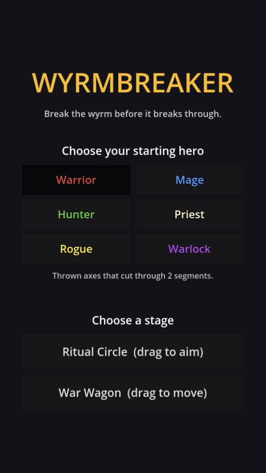
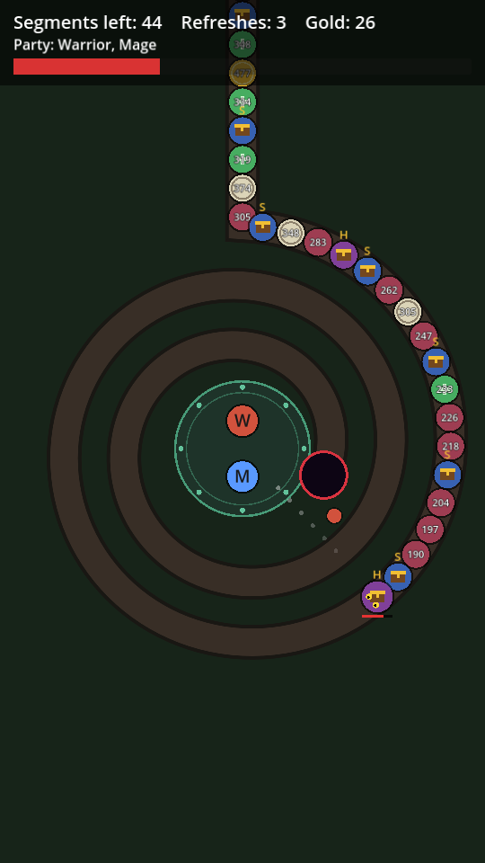
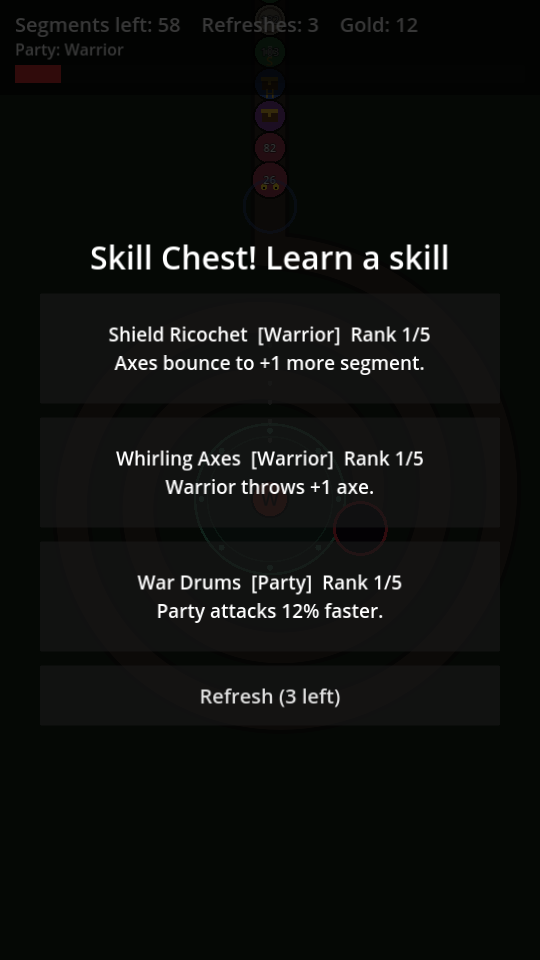

# Wyrmbreaker

An Android roguelike chain-defense game in the style of *Dragon Fever TD* /
*Cell Survivor*, with a classic fantasy-RPG party. A segmented wyrm crawls
along a track; shoot it apart before it reaches the end. Breaking chest
segments recruits heroes and teaches skills (pick 1 of 3, with refreshes).

See [`docs/DESIGN.md`](docs/DESIGN.md) for the full design.

| Menu | Ritual Circle | Skill chest | War Wagon |
|---|---|---|---|
|  |  |  |  |

## Status: prototype (milestone 1)

- Two stage types: **Ritual Circle** (party in the center, drag to aim) and
  **War Wagon** (drag to move the wagon along the bottom)
- 6 heroes (Warrior, Mage, Hunter, Priest, Rogue, Warlock), 28 skills
- Segment types: flesh, bone (armored), mending (heals neighbours), gilded
  (+gold, +1 refresh), hero chest, skill chest
- Placeholder shapes for all art; no meta progression yet

## Get the APK

Every push runs the **Test & build Android APK** GitHub Actions workflow.
Open the latest run under the repo's *Actions* tab and download the
`wyrmbreaker-debug-apk` artifact, then unzip it and install the `.apk` on your
phone (you'll need to allow installing apps from unknown sources).

## Run it on a computer

1. Install [Godot 4.3](https://godotengine.org/download) (standard build).
2. Open this folder as a project and press **F5**. Mouse clicks and drags act
   as touches.

## Project layout

| Path | What's there |
|---|---|
| `scripts/data.gd` | All balance data: heroes, skills, segment types |
| `scripts/run_state.gd` | Party, skill ranks, refreshes, gold; offer rolls |
| `scripts/wyrm.gd` | The chain: movement, damage, DoTs, drawing |
| `scripts/stage.gd` | A stage: input, party firing, projectiles, chests, HUD |
| `scripts/track_builder.gd` | Spiral and serpentine track shapes |
| `scripts/pick_panel.gd` | The "pick 1 of 3" chest overlay |
| `scripts/main.gd` | Main menu and scene switching |
| `tests/sim_test.tscn` | Headless bot that plays every hero on both stages |
| `tests/screenshot.tscn` | Captures preview screenshots |

## Tests

```sh
godot --headless --import
godot --headless --fixed-fps 60 res://tests/sim_test.tscn -- runs=1
```

The bot aims at the front of the chain and always takes the first offer.
It prints one line per run (win/loss, time, peak danger, party size) and a
win total. With the current balance it wins roughly 75% of runs.
