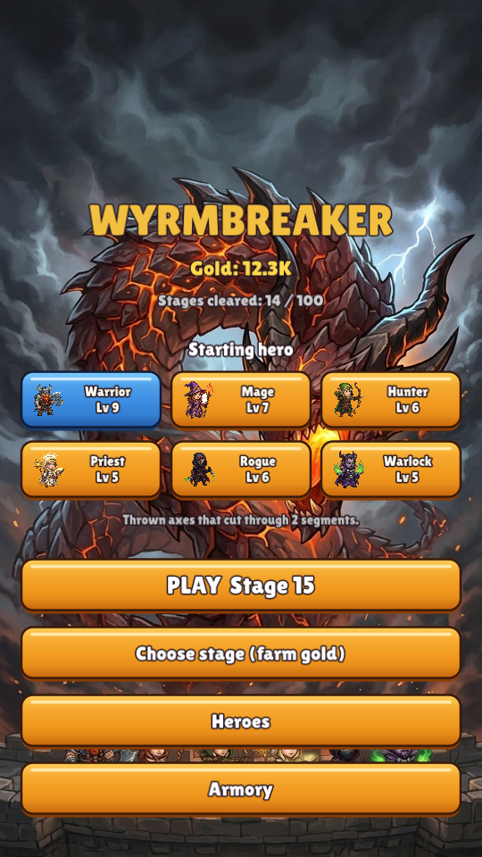
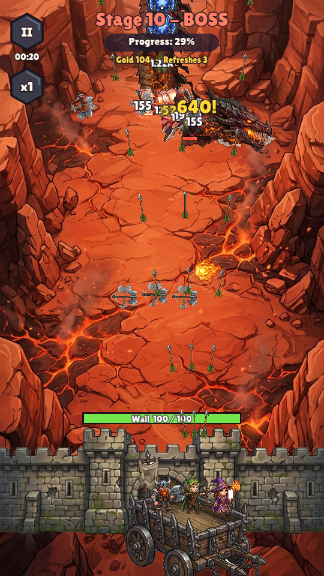
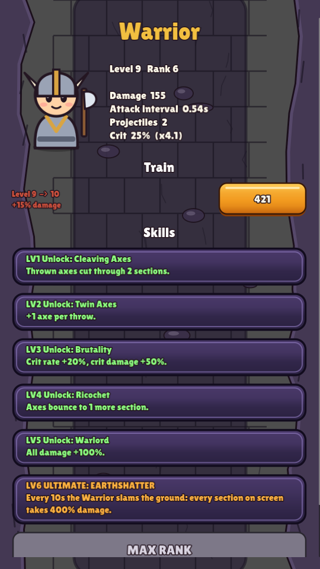
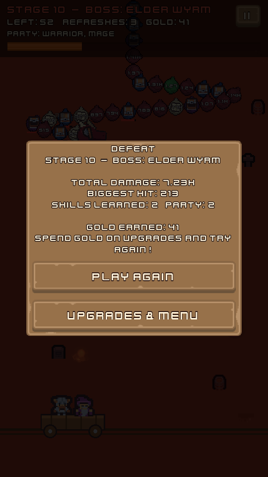

# Wyrmbreaker

An Android roguelike chain-defense game in the style of *Dragon Fever TD* /
*Cell Survivor*, with a classic fantasy-RPG party. A segmented wyrm crawls
along a track; shoot it apart before it reaches the end. Breaking chest
segments recruits heroes and teaches skills (pick 1 of 3, with refreshes).

See [`docs/DESIGN.md`](docs/DESIGN.md) for the full design.

| Home | War Wagon (boss) | Hero ranks | End of run |
|---|---|---|---|
|  |  |  |  |

## Status

**Milestone 1, playable prototype**
- Two stage types:
  - **Ritual Circle:** the party is in the center; drag to aim.
  - **War Wagon:** drag to move the wagon along the bottom.
- 6 heroes (Warrior, Mage, Hunter, Priest, Rogue, Warlock)
- Segment types: flesh, bone (armored), mending (heals neighbours), gilded
  (+gold, +1 refresh), hero chest, skill chest

**Milestone 2, roguelite progression**
- **100 stages** with exponential HP scaling and an Elder Wyrm boss every 10
- **Gold:** kept even when you lose; replay stages to farm it
- **Heroes:** Train with gold, and rank LV1–6 with hero shards. Each rank
  unlocks a perk, and **LV6 is a screen-wide ultimate**
- **Armory:** Might, Haste, Ferocity, Fortune, Insight, Treasure Hunter,
  Head Start, Fortify
- **34 skills:** skill rarities (Rare = +2 ranks, Epic = +3), plus one
  **Legendary** per hero
- Floating damage numbers, big-number formatting and end-of-run damage stats
- Automatic save

**Art and audio**
- Original cartoon SVG art:
  - Four wyrm types: fire dragon, ice drake, bone wyrm, sea serpent
  - Armored body plates and chest orbs
  - Chibi heroes
  - Four themed backgrounds
  - The wall and UI
- Kenney CC0 particle effects and sounds, and the Lilita One font. See
  [`assets/CREDITS.md`](assets/CREDITS.md).
- Wyrm paths are hidden and vary per stage: 7 path shapes and 3 speed
  patterns.

## Get the APK

Every push runs the **Test & build Android APK** GitHub Actions workflow.
Open the latest run under the repo's *Actions* tab and download the
`wyrmbreaker-debug-apk` artifact, then unzip it and install the `.apk` on your
phone (you'll need to allow installing apps from unknown sources).

## Run it on a computer

1. Install [Godot 4.3](https://godotengine.org/download) (standard build).
2. Open this folder as a project and press **F5**. Mouse clicks and drags act
   as touches.

## Project layout

| Path | What's there |
|---|---|
| `scripts/data.gd` | In-run balance data: heroes, skills, rarities, segment types |
| `scripts/meta.gd` | Save game, gold, permanent upgrades and their costs |
| `scripts/stage_config.gd` | Procedural stage 1–100 difficulty curve |
| `scripts/run_state.gd` | Party, skill ranks, refreshes, gold; offer rolls |
| `scripts/wyrm.gd` | The chain: movement, damage, DoTs, drawing |
| `scripts/stage.gd` | A stage: input, party firing, projectiles, chests, HUD |
| `scripts/track_builder.gd` | Spiral and serpentine track shapes |
| `scripts/pick_panel.gd` | The "pick 1 of 3" chest overlay |
| `scripts/main.gd` | Home, stage select, upgrades shop, scene switching |
| `scripts/art.gd`, `scripts/ui_theme.gd`, `scripts/sfx.gd` | Textures, UI theme, sound effects |
| `tools/hd_art.py` | Generates the SVG wyrm heads, backgrounds and heroes |
| `tools/import_assets.py` | Rebuilds the Kenney effects and sounds in `assets/` |
| `tests/track_preview.tscn` | Renders every (normally hidden) path shape |
| `tests/sim_test.tscn` | Headless bot: smoke test, or a full farming "career" to stage 100 |
| `tests/screenshot.tscn` | Captures preview screenshots |

## Tests

```sh
godot --headless --import
# Smoke test: every starting hero on stages 1 and 2, no upgrades
godot --headless --fixed-fps 60 res://tests/sim_test.tscn -- mode=smoke stages=1,2
# Balance check: fresh save, bot farms and buys upgrades until stage 100
godot --headless --fixed-fps 60 res://tests/sim_test.tscn -- mode=career target=100
```

The bot aims at the front of the chain and always takes the first offer.
In career mode, after every run it spends all its gold on the cheapest
upgrade, then plays the next unlocked stage again. The output shows how many
runs each stage took, which is how the difficulty curve gets tuned.
